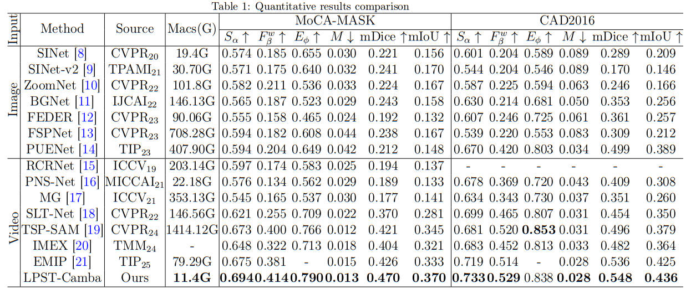
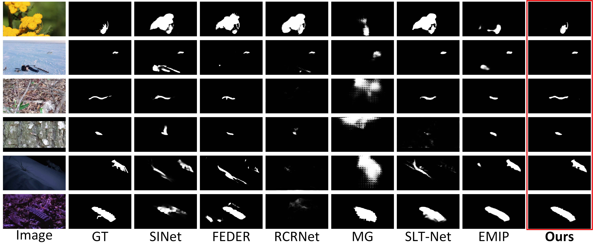
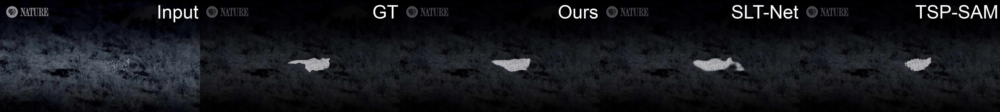

## LPST-Camba: Efficient Long-Prior-Guided Spatio-Temporal Mamba for Video Camouflaged Object Detection  
This repository contains the code for our paper

## 1. Highlights :fire:

- We propose LPST-Camba, an efficient Mamba-based VCOD framework that achieves strong temporal modeling with low computational cost.
- We design a Hilbert-curve-based Local Enhancement Mamba (LEM) module to preserve spatial locality and enhance fine-grained camouflaged object structures.
- We introduce a Prior Spatio-Temporal Mamba (PSTM) module that exploits historical prediction priors to focus temporal scanning on informative target patches.
- Extensive experiments on MoCA-MASK and CAD2016 demonstrate that LPST-Camba outperforms representative image COD and VCOD methods while requiring only 11.4G MACs.

## 2. Main Results :balloon:

**Quantitative comparisons with state-of-the-arts.** 

**Visual comparisons with state-of-the arts.** 

## 3. Demo videos :video_camera:

We demonstrate the video results of our LPST-Camba with previous state-of-the-art model SLT-Net and TSP-SAM on MoCA-Mask test dataset.

